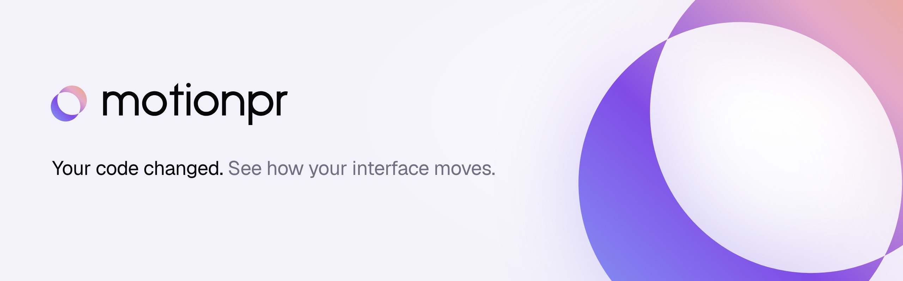
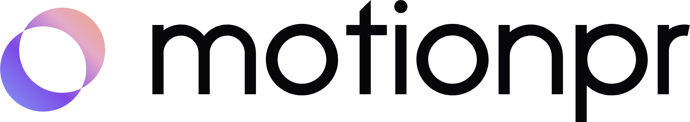

<div align="center">

<picture>
  <source media="(prefers-color-scheme: dark)" srcset="brand/social/motionpr-banner-dark.jpg">
  
</picture>

<h3>Animation regression testing for the web</h3>

Capture every animation and scroll in a real browser. Compare it with an approved baseline. See the difference, frame by frame.

[](https://github.com/erenthedeveloper0/motionpr/actions/workflows/ci.yml)
[](https://www.npmjs.com/package/@erenthedeveloper0/motionpr)
[](https://nodejs.org)
[](docs/advanced/support-matrix.md)
[](docs/configuration/privacy.md)
[](LICENSE)

[Website](https://erenthedeveloper0.github.io/motionpr/) · [Documentation](https://erenthedeveloper0.github.io/motionpr/docs/) · [Interactive demo](https://erenthedeveloper0.github.io/motionpr/demo/) · [Changelog](CHANGELOG.md) · [Roadmap](ROADMAP.md) · [Contributing](CONTRIBUTING.md)

</div>


> [!IMPORTANT]
> **Alpha.** Published to npm on the `alpha` tag for feedback, not for production use: the
> capture format and the API can still change before `1.0`. Chromium only. See [Status](#status).

```bash
npm install -D @erenthedeveloper0/motionpr@alpha
npx motionpr install   # Chromium, once per machine
npx motionpr init      # writes motionpr.config.ts
npx motionpr run       # capture → compare with the baseline → report
```

```ts
// motionpr.config.ts
import { defineConfig } from "@erenthedeveloper0/motionpr";

export default defineConfig({
  baseURL: "http://localhost:3000",
  webServer: {
    command: "npm run dev",
    url: "http://localhost:3000",
    reuseExistingServer: !process.env.CI,
  },
  scenarios: [
    {
      id: "menu",
      steps: [
        { type: "click", selector: "[data-testid=menu-toggle]" },
        { type: "capture", label: "open" },
      ],
    },
  ],
});
```

Change a `transition` from `300ms cubic-bezier(0.16, 1, 0.3, 1)` to `600ms ease-in-out` and run
again. This is MotionPR's real output:

```text
  ✖ menu-open@default  1 critical · 1 warning · 1 info
      ✖ menu-open: css-transition “transform” on menu: Duration 300ms → 600ms (+300ms, +100%)
      ▲ menu-open: css-transition “transform” on menu: Easing cubic-bezier(0.16, 1, 0.3, 1) → ease-in-out (max deviation 70% of …
      ● menu-open: css-transition “transform” on menu: translateX path deviates up to 195.3px at 26% progress

  Result  FAILED  fail on: critical  1 critical · 1 warning · 1 info
```

The command exits `1`, and `.motionpr/report/index.html` plays both versions side by side, on one
clock, frame by frame.

**Contents**: [The idea](#the-idea) · [What it catches](#what-it-catches) ·
[Status](#status) · [Integrations](#integrations) · [How it works](#how-it-works) ·
[CI](#ci) · [Try it](#try-it) · [Layout](#layout) · [Documentation](#documentation) ·
[Contributing](#contributing)


## The idea

> Your code changed. See how your interface moves.

Motion is behaviour, and it is the part of a change code review sees least. A pull request that
turns `320ms` into `560ms`, or swaps a tuned `cubic-bezier()` for a design-token `ease-in-out`,
reads like cleanup. Unit tests assert on state, end-to-end tests wait for animations to finish,
and screenshot tests compare the settled frame, which is the same before and after.

MotionPR records motion as **data**: every animation's timing, easing curve (65 samples), animated
properties and sampled computed values, every timeline's labels, and every scroll's position over
time. Data can be compared exactly, with tolerances you choose, and every difference gets a
severity from a named rule.

The logo is the same idea. Take a circle, move it, overlay both positions and keep only the pixels
that changed: what remains is the MotionPR mark. If nothing moves differently, the mark
disappears. The website's hero draws it from the demo app's real baseline and candidate.


## What it catches

| A change in your code                                   | What MotionPR reports (real messages)                                                                          |
| ------------------------------------------------------- | -------------------------------------------------------------------------------------------------------------- |
| `transition` duration and easing                        | `Duration 320ms → 560ms (+240ms, +75%)` · `Easing … → ease-in-out (max deviation 70% of progress at 27% time)` |
| A `clip-path` reveal animation deleted                  | **critical** `Removed: css-animation “wipe-in” on case-image`                                                  |
| `element.animate()` stagger from 70 to 120 ms           | `Stagger interval 70ms → 120ms across 6 elements`                                                              |
| GSAP `power3.out` → `back.out(1.7)`                     | `Easing power3.out → back.out(1.7) (max deviation 16% of progress at 41% time; now overshoots)`                |
| An Anime.js timeline step moved from `-=120` to `+=120` | `Label “ship” moved 600ms → 840ms`, `Timeline duration 840ms → 1080ms`                                         |
| Lenis `lerp` from 0.1 to 0.06                           | `Scroll takes 1228ms → 2045ms to settle (+817ms)`, `Peak scroll velocity 6.54 → 4.31 px/ms (-34%)`             |
| A ScrollTrigger `start` moved                           | `Scroll-linked progress at the same scroll position differs by up to 14%`                                      |
| An element matched only by DOM position changed         | **uncertain**, never a failure: `(element matched by DOM position only)`                                       |

Every row comes from the bundled demo app, whose candidate variant contains eleven deliberate
motion changes; `npx motionpr demo` reproduces them. Severities, rules and their rationale are
in [Severity & thresholds](docs/features/severity.md).


## Status

**Alpha — `0.1.0-alpha`, the first public release.** It works end to end on real browsers for the
engines below, and every claim in the documentation is backed by an automated test. Do not put it
on a path that blocks production releases yet: the capture format and the public API may change
before `1.0`. Older captures are migrated when they are read.

### Working today

- **Capture** of CSS transitions, CSS animations and Web Animations, with deterministic replay
  (paused clones, callbacks muted), sampled computed styles and geometry, and content-addressed
  filmstrips.
- **Adapters** for GSAP (tweens, timelines, staggers, keyframes; ScrollTrigger as metadata plus
  live progress), Anime.js v4 (animations, timelines, staggers, `waapi.animate`) and Lenis (scroll
  motion), all through public APIs and no-ops outside a capture.
- **Scroll motion** as its own record, recorded live and compared by distance, settle time,
  normalized progress curve, peak velocity, overshoot and lag.
- **Comparison** of timing, easing curves, iterations, direction, playback rate, staggers,
  keyframes, trajectories, opacity and size, timelines and labels, scroll, and settled pixels,
  with severities from named, overridable rules and uncertainty kept separate from regressions.
- **An offline report viewer**: side by side, overlay, onion skin with motion paths, wipe, pixel
  difference, a shared timeline with easing curves, an inspector, and keyboard navigation.
- **A CLI** (`init`, `install`, `capture`, `compare`, `run`, `baseline`, `report`, `doctor`, `demo`)
  with CI exit codes, JSON and Markdown output, and a least-privilege GitHub Actions template.

### Not built yet

Firefox and WebKit · Windows in CI · replaying scroll-linked tween values · nested native scroll
containers · Shadow DOM selector piercing · example projects. The [roadmap](ROADMAP.md) orders
them, and [Limitations](docs/advanced/limitations.md) lists every known gap.


## Integrations

| Integration                                      | Role                           | Support                                                                     |
| ------------------------------------------------ | ------------------------------ | --------------------------------------------------------------------------- |
| Native CSS (transitions, animations)             | Animation                      | Verified (Chromium), no setup                                               |
| Web Animations API (`element.animate`)           | Animation                      | Verified (Chromium), no setup                                               |
| GSAP · `@erenthedeveloper0/motionpr/gsap`        | Animation, timelines           | Verified with 3.15.1 (`>=3.12 <4`); ScrollTrigger: metadata + live progress |
| Anime.js · `@erenthedeveloper0/motionpr/animejs` | Animation, timelines, staggers | Verified with 4.5.0 (`>=4 <5`); v3 is not supported                         |
| Lenis · `@erenthedeveloper0/motionpr/lenis`      | Scroll motion                  | Verified with 1.3.27 (`>=1.1 <2`)                                           |
| CSS scroll-driven animations                     | Animation                      | Metadata only                                                               |

"Verified" means covered by automated tests against a real browser in this repository. The engines
are optional peer dependencies.

```ts
import gsap from "gsap";
import { motionprGsap } from "@erenthedeveloper0/motionpr/gsap";
motionprGsap.register(gsap); // a no-op unless MotionPR is capturing the page
```

Guides: [Native CSS](docs/integrations/native-css.md) · [WAAPI](docs/integrations/web-animations.md) ·
[GSAP](docs/integrations/gsap.md) · [Anime.js](docs/integrations/animejs.md) ·
[Lenis](docs/integrations/lenis.md) · [Combining adapters](docs/integrations/combining-adapters.md).


## How it works

1. **Capture.** MotionPR opens each scenario in Chromium and injects an agent before your scripts
   run. Your steps drive the page with real input; adapters report GSAP, Anime.js and Lenis.
2. **Analyze.** When motion settles, the window is replayed at exact times with callbacks muted, to
   sample computed values and render frames. Scroll is recorded live and never replayed.
3. **Compare.** Records are matched by element identity, type and name, then compared field by
   field and curve by curve. Every difference gets a severity from a rule.
4. **Inspect.** An offline HTML report plays baseline (blue) and candidate (peach) on one clock.
5. **Report.** A summary, a Markdown step summary in GitHub Actions, and an exit code.

The internals are in [Architecture](docs/advanced/architecture.md).

## CI

`npx motionpr init --github` writes a workflow that needs only `contents: read`, pins every action
to a commit SHA, runs `motionpr run --ci`, and uploads the report as an artifact even when the
job fails. Exit codes: `0` within thresholds, `1` regression, `2` error.
See [GitHub Actions](docs/ci/github-actions.md).


## Try it

```bash
npx @erenthedeveloper0/motionpr@alpha install   # Chromium
npx @erenthedeveloper0/motionpr@alpha demo      # the demo app in two versions, and a real report
```

Or work on the repository (Node ≥ 22.18 and pnpm through Corepack):

```bash
git clone https://github.com/erenthedeveloper0/motionpr.git && cd motionpr
corepack enable && pnpm install
npx playwright-core install chromium
pnpm build                  # agent bundle, report viewer, demo app, CLI
pnpm typecheck && pnpm lint && pnpm format:check
pnpm test                   # unit tests
pnpm test:integration       # real Chromium: capture engine, adapters, CLI
pnpm test:e2e               # the demo app captured for real; the report viewer and the website driven like a user
pnpm pack:check --install   # what ships to npm, installed into a clean project and run
pnpm dev:docs               # the website on http://localhost:4321/motionpr/
```

### What the tests cover

| Suite                                         | What it proves                                                                                                                                                                             |
| --------------------------------------------- | ------------------------------------------------------------------------------------------------------------------------------------------------------------------------------------------ |
| `packages/core/tests`                         | Config schema and defaults, easing parsing and evaluation (Chromium-exact to 1e-4), capture/comparison schemas, v1 → v2 migrations, path-traversal guards                                  |
| `packages/comparison/tests`                   | Matching, every comparison rule and its thresholds, stagger detection, scroll metrics, regressions found earlier                                                                           |
| `packages/capture/tests`                      | The agent in real Chromium: discovery, settling, deterministic replay, filmstrips, privacy masks, memory                                                                                   |
| `packages/adapters/*/tests`                   | GSAP, Anime.js (including a sample-for-sample port of its eases) and Lenis adapters in real Chromium, with lifecycle and cleanup                                                           |
| `packages/report/tests`, `e2e/report.spec.ts` | Report generation and the viewer driven like a user                                                                                                                                        |
| `packages/cli/tests`                          | Every command, exit codes, prompts that refuse in CI, a three-engine `motionpr run`                                                                                                        |
| `e2e/demo-expectations.spec.ts`               | Every intended change in the demo app is found, and nothing else is reported                                                                                                               |
| `e2e/docs-site.spec.ts`                       | The website: every route and link, soft navigation with history and scroll restoration, animation cleanup, search, copy, mobile, reduced motion, keyboard, and every interactive component |
| `scripts/tests/docs.test.ts`                  | Every export, step type, CLI command and config section is documented; config examples validate against the schema; no workflow can publish to npm                                         |
| `scripts/pack-check.mjs`                      | The npm tarball: an allowlist of files, entry points, types, and an install into a clean project                                                                                           |


## Layout

```text
packages/
  core/          schemas (capture/comparison v2), config, easing math, adapter protocol, storage
  capture/       Playwright runner and the in-page agent
  comparison/    matching, animation/scroll/timeline comparison, severity, visual diff
  report/        the offline report viewer (React, one HTML file) and its generator
  adapters/      gsap · animejs · lenis (browser code)
  cli/           the motionpr CLI and public entry points: the only published package
apps/docs/       the website: landing page, documentation, interactive demo, playground
docs/            the documentation, in Markdown (rendered by apps/docs, readable on GitHub)
fixtures/        the demo app, with baseline and candidate variants
e2e/             Playwright tests: demo expectations, report viewer, website
brand/           the MotionPR brand: logo geometry, logos, icons, social images
scripts/         pack check, release preparation, version sync, demo capture
```

`@erenthedeveloper0/motionpr` bundles the private workspace packages; its tarball contains only
`dist/`, `README.md`, `LICENSE` and `THIRD_PARTY_NOTICES.md`.

## Documentation

- **Start:** [Introduction](docs/overview/introduction.md) · [Requirements](docs/getting-started/requirements.md) ·
  [Installation](docs/getting-started/installation.md) · [First capture](docs/getting-started/first-capture.md) ·
  [First comparison](docs/getting-started/first-comparison.md)
- **Features:** [Interaction scenarios](docs/features/interaction-scenarios.md) · [Motion comparison](docs/features/motion-comparison.md) ·
  [Easing analysis](docs/features/easing-analysis.md) · [Severity & thresholds](docs/features/severity.md) ·
  [HTML reports](docs/features/html-reports.md)
- **Reference:** [CLI](docs/cli/overview.md) · [Configuration](docs/configuration/config-file.md) ·
  [Public API](docs/advanced/public-api.md) · [Capture serialization](docs/advanced/capture-serialization.md)
- **Operations:** [GitHub Actions](docs/ci/github-actions.md) · [Baseline management](docs/ci/baseline-management.md) ·
  [Troubleshooting](docs/advanced/troubleshooting.md) · [Privacy](docs/configuration/privacy.md)

Everything is also on the website, with search: **https://erenthedeveloper0.github.io/motionpr/docs/**


## Contributing

Contributions are welcome. [CONTRIBUTING.md](CONTRIBUTING.md) has the setup, the checks and the
conventions; [SECURITY.md](SECURITY.md) explains how to report a vulnerability privately, and
[SUPPORT.md](SUPPORT.md) where to ask questions. Three rules worth knowing up front:

1. **A claim needs a test.** A compatibility claim in the docs needs a real-browser test; a
   documented option needs to exist in the schema. `scripts/tests/docs.test.ts` checks both.
2. **Uncertainty is not a regression.** When MotionPR cannot be sure (a weak element match,
   incomplete data), the difference is `uncertain` and never fails a run by default.
3. **Adapters read public APIs only**, never re-fire application callbacks, and leave every engine
   exactly as they found it.

## Licence

[MIT](LICENSE) © [Eren Sümer](https://github.com/erenthedeveloper0). Third-party components bundled
into the package are listed in [THIRD_PARTY_NOTICES.md](THIRD_PARTY_NOTICES.md); contributors in
[CONTRIBUTORS.md](CONTRIBUTORS.md).

<br>

<div align="center">
  <picture>
    <source media="(prefers-color-scheme: dark)" srcset="brand/logo/png/motionpr-logo-on-dark.png">
    
  </picture>
  <br>
  <sub>Built by <a href="https://github.com/erenthedeveloper0">Eren Sümer</a> · your code changed, see how your interface moves</sub>
</div>
