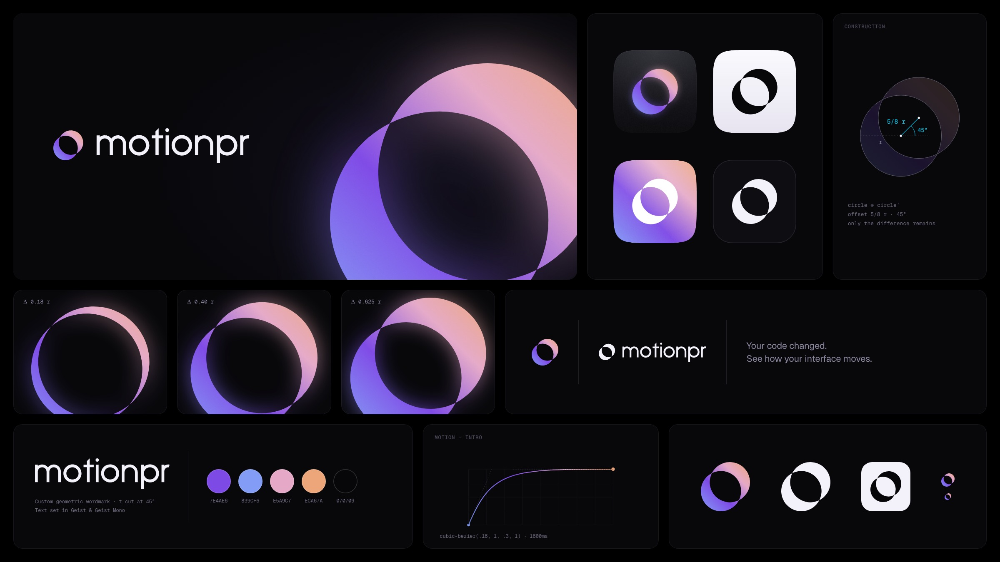

# MotionPR brand



## The idea: the mark is a diff

Take a circle. Move it. Overlay the two positions and keep only the pixels that changed (the exclusive-or).
What's left is two crescents: the MotionPR mark.

It is exactly what an image diff of a moving element looks like, so the logo describes the product:
**your code changed, and the only thing that shows is how it moved.** If nothing moves, the mark disappears.
That makes it work as an animation too: the crescents grow out of nothing as the circles separate.

The crescents also continue the light-arc horizons from the original MotionPR brand board, and the
gradient runs along the direction of motion, from cool (before) to warm (after).

## Construction

| Element  | Rule |
|---|---|
| Mark     | Two circles of radius `r`, offset by `5/8 r` along 45° (lower-left to upper-right). Fill = XOR. |
| Wordmark | Drawn, not typeset. Geometric lowercase, x-height 100, stems 16, rounds 16.8 (+5% optical gain), overshoot 1.6. The top of the `t` is cut at 45°, the same angle as the mark's motion. The `i` dot aligns with the top of the `t`. |
| Lockup   | The mark is 1.5 × x-height, centred on the x-height. The gap between mark and wordmark is 0.45 × the mark. |

All geometry lives in [`source/motionpr-logo.mjs`](source/motionpr-logo.mjs) (zero dependencies).
`node brand/source/build-svgs.mjs` regenerates every SVG in this folder from it.

To animate the mark in code, change `offset` and keep `size` fixed. The radius is locked to the final pose,
so the mark never resizes:

```js
import { markGeometry, MARK_OFFSET } from './brand/source/motionpr-logo.mjs';

const d = markGeometry({ size: 32, offset: progress * MARK_OFFSET }).path; // progress 0 → 1
```

## Colour

| Token    | Hex       | Role |
|---|---|---|
| Ink      | `#070709` | Backgrounds, mono logo on light |
| Paper    | `#F3F1FA` | Mono logo on dark, text on dark |
| Graphite | `#111116` | Surfaces, app-icon tile |
| Blue     | `#839CF6` | Gradient stop 0 |
| Violet   | `#7E4AE6` | Gradient stop 0.38 |
| Pink     | `#E5A9C7` | Gradient stop 0.72 |
| Peach    | `#ECA67A` | Gradient stop 1 |

The palette was sampled from the original brand board. The gradient always runs lower-left → upper-right,
across the mark's own bounding box.

## Typography

The wordmark is custom artwork. Never set "motionpr" in a font and use it as the logo.

For product UI, docs and reports use **Geist** and **Geist Mono** (SIL Open Font License). The original board
referenced Neue Montreal, which is a commercial typeface. Geist can be freely bundled into offline HTML reports.

## Usage

- **Clear space:** keep at least half the mark's height free on every side.
- **Minimum size:** 16 px tall for both the lockup and the mark. Both were checked at that size on light
  and dark backgrounds. 24 px or larger is recommended for the lockup.
- **On dark:** gradient mark with a Paper wordmark (`motionpr-logo-on-dark.svg`), or all Paper.
- **On light:** gradient mark with an Ink wordmark (`motionpr-logo-on-light.svg`), or all Ink.
- **On photos, busy or mid-tone backgrounds:** use the mono versions only.
- **Glow and grain** belong to hero compositions (banners, social cards). Never add them to the logo itself.

Don't:

- rotate or mirror the mark (the 45° is the direction of motion);
- change the circle offset, or make the circles different sizes;
- stroke or outline the mark;
- reorder, recolour or re-angle the gradient;
- stretch, condense or re-space the wordmark;
- put the mark inside another shape, except the supplied app icons.

## Motion

| File | Behaviour |
|---|---|
| `motion/motionpr-mark-intro.svg` | Plays once: the circles separate from a single point. `cubic-bezier(.16, 1, .3, 1)`, 1600 ms, 350 ms delay. |
| `motion/motionpr-mark-loop.svg`  | Loader: the offset breathes between 100% and 30%. `cubic-bezier(.65, 0, .35, 1)`, 1800 ms, alternate. |

Both are plain SVG with CSS animation. They work in an `` tag, and they show the static mark when the
viewer has reduced motion enabled (`prefers-reduced-motion: reduce`).

## Files

| Path | Use |
|---|---|
| `logo/motionpr-logo-on-dark.svg` · `-on-light.svg` | Primary lockups (gradient mark) |
| `logo/motionpr-logo-white.svg` · `-black.svg` · `-currentcolor.svg` | Mono lockups |
| `logo/motionpr-mark.svg` | Gradient mark |
| `logo/motionpr-mark-white.svg` · `-black.svg` · `-currentcolor.svg` | Mono marks |
| `logo/motionpr-wordmark-*.svg` | Wordmark only |
| `logo/png/` | Transparent PNGs (2000 px lockups, 1024 px marks) for tools that don't accept SVG |
| `icon/motionpr-app-icon.svg` · `-light.svg` · `-gradient.svg` | App icons (1024, superellipse tile) |
| `icon/motionpr-app-icon-1024.png` | Raster app icon |
| `icon/favicon.svg` · `favicon.ico` | Favicons (the ICO holds 16, 32 and 48 px) |
| `icon/apple-touch-icon.png` | 180 px, opaque (iOS applies its own mask) |
| `icon/icon-192.png` · `icon-512.png` · `icon-maskable-512.png` | Web app manifest icons |
| `icon/motionpr-icon-full-bleed.svg` | Source for the opaque and maskable icons |
| `social/motionpr-social-preview.jpg` | GitHub social preview, 1280 × 640 (Settings → General → Social preview) |
| `social/motionpr-banner-dark.jpg` · `-light.jpg` | README header, 2560 × 800 |
| `motion/` | Animated marks |
| `motionpr-brand-board.jpg` | Overview |

### Snippets

README header that follows the viewer's colour scheme:

```html
<picture>
  <source media="(prefers-color-scheme: dark)" srcset="brand/social/motionpr-banner-dark.jpg">
  
</picture>
```

Favicons:

```html
<link rel="icon" href="/favicon.ico" sizes="32x32">
<link rel="icon" href="/favicon.svg" type="image/svg+xml">
<link rel="apple-touch-icon" href="/apple-touch-icon.png">
```

Web app manifest icons:

```json
"icons": [
  { "src": "/icon-192.png", "sizes": "192x192", "type": "image/png" },
  { "src": "/icon-512.png", "sizes": "512x512", "type": "image/png" },
  { "src": "/icon-maskable-512.png", "sizes": "512x512", "type": "image/png", "purpose": "maskable" }
]
```
