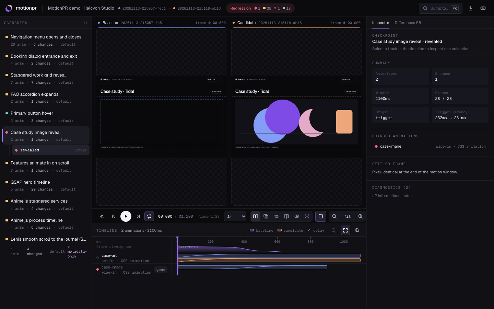

# HTML reports

`motionpr run` and `motionpr compare` write `.motionpr/report/index.html`. It is a single,
self-contained file plus an `assets/` folder of frames. It opens from disk (`file://`), needs no
server and makes no network requests. Open it with `npx motionpr report --open`, or download it
from a CI artifact.

The report of the demo app, generated by MotionPR from its two variants, is published with this
site: [open the demo report](https://erenthedeveloper0.github.io/motionpr/report/). It is the
same kind of report `motionpr run` writes.

The report uses a consistent colour code taken from the MotionPR mark: **blue is the baseline
(before)**, **peach is the candidate (after)**. Violet marks selection and focus.

## Top bar

Project name, the two capture ids (hover for date, platform and browser), and the result:
_Regression_ when a configured threshold was exceeded, _Within thresholds_ otherwise, with counts
per severity. The download button exports `comparison.json`, the capture files, a Markdown
summary (copied to the clipboard, ready for a pull request) or a print/PDF view.

## Scenario navigator (left)

Every scenario × viewport with its highest severity, animation count, number of changes and
capture completeness (◇ marks partial data). The selected scenario lists its checkpoints with
their motion-window length. Failed scenarios show their error.

## Stage (centre)

The frames of the selected checkpoint at the playhead time, for both versions, always in sync.

The principle in miniature, from the demo app's real capture of its navigation panel: one clock
drives both versions, so a timing or easing change shows up as the two drifting apart.

<!-- motionpr:compare dataset="navigation/open" -->

| Mode         | Key | What it shows                                                                                                                                  |
| ------------ | --- | ---------------------------------------------------------------------------------------------------------------------------------------------- |
| Side by side | `1` | Baseline and candidate next to each other; zoomed views scroll together                                                                        |
| Overlay      | `2` | Candidate over baseline with an opacity slider                                                                                                 |
| Onion skin   | `3` | The last frames as ghosts, plus the **motion path** of the selected element (or of every changed one) from its sampled geometry, blue vs peach |
| Wipe         | `4` | A draggable divider (arrow keys move it when focused)                                                                                          |
| Difference   | `5` | A true per-pixel difference blend: black where the frames are identical                                                                        |
| Pixel diff   | `6` | The pixelmatch diff of the settled end frames, with counts and the threshold                                                                   |

Element boxes (`B`) outline animated elements at the current time. The selected element is solid
and labelled. Zoom with `+`/`−`, fit with `0`.

Frames are rendered deterministically by MotionPR (not screen-recorded), so the same time shows
the same state on every run.

## Transport

Play/pause (`Space`), step frames (`←`/`→`, `Shift` for 10), jump to start/end (`Home`/`End`),
loop, and playback speed from 0.1× to 2×.

## Timeline (bottom)

One row per animation. Each row has a thin baseline bar and a candidate bar:

- the hatched part is the **delay**; the solid part is the active duration;
- the line inside a bar is the animation's **easing curve**;
- tick marks separate iterations, and a fading end marks infinite animations;
- an amber mark flags a changed animation; _new_ and _gone_ tag added and removed ones.

Above the rows, the **frame divergence** strip charts the share of pixels that differ between
time-aligned frames, so you can see when the two versions diverge. Click or drag the ruler to
scrub. Zoom with `Ctrl`/`⌘` + mouse wheel or the buttons. Use `↑`/`↓` to move between rows.

`t = 0` is the first animation start of the window. The header shows how long after the input event
that was (_input → motion latency_).

## Inspector (right)

With no animation selected: checkpoint summary, changed animations, stagger changes, the
settled-frame visual result and diagnostics (warnings first, informational notes folded).

With an animation selected:

- **Changes** with severity, the rule that produced it, and how it was measured;
- **Timing** table, baseline vs candidate with deltas. `—` means _not captured_ (hover to see
  why), which is different from `0`;
- **Easing curve**: both curves over normalised time, sample points, the point of largest
  deviation, the live progress of each side and a hover crosshair with exact values;
- **Sampled values**: a measured channel (translate, scale, rotate, opacity, box x/y/size) over time;
- **Properties**: declared keyframe values per property;
- **Element**: identity key, matching method and confidence, selector, live bounds;
- **Capture completeness**: why data is partial, if it is.

## Differences explorer

Every difference, filterable by severity, category (added, removed, changed, timing, easing,
properties, visual, uncertain, structure) and free text. Selecting one jumps to its scenario,
checkpoint and animation. `N`/`P` cycle through differences from anywhere.

## Measurement labels

| Label       | Meaning                                                                     |
| ----------- | --------------------------------------------------------------------------- |
| measured    | Read directly from both captures (declared timing, sampled computed styles) |
| estimated   | Derived with tolerance; start times and latency are frame-quantized         |
| incomplete  | At least one side has partial capture data                                  |
| unsupported | The comparison cannot be made for this animation type                       |

## Keyboard

`⌘K`/`Ctrl+K` opens the command menu (jump to any scenario, checkpoint, animation, difference or
action). `?` lists all shortcuts.
