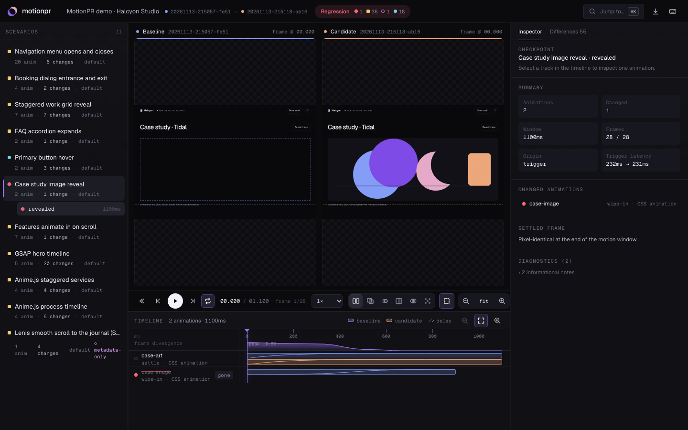

# Your first report

```bash
npx motionpr report --open
```

Each engine's report is `.motionpr/report/<browser>/index.html` (`report/chromium/` for the
default engine): one self-contained HTML file plus an `assets/` folder of frames. It opens from
disk (`file://`), needs no server and makes no network requests, so the same file works when you
download it from a CI run. `.motionpr/report/index.html` lists every engine's report with its
result; the report's top bar names the engine its captures were taken with.



The screenshot is the report `motionpr demo` produces. Colours follow the MotionPR mark:
**blue is the baseline** (before), **peach is the candidate** (after), violet marks focus.

## Read it in four moves

1. **Top bar** — the result (_Regression_ or _Within thresholds_) and counts per severity.
2. **Scenario navigator** (left) — pick `menu-open@default`, then its checkpoint `menu-open`.
3. **Timeline** (bottom) — the menu's row has a thin blue bar (300 ms) and a peach bar (600 ms).
   The curve inside each bar is its easing. Press `Space` to play both versions on one clock, or
   drag the ruler to scrub.
4. **Inspector** (right) — select the row to see each change with its severity and rule, the
   timing table with deltas, both easing curves with the point of largest deviation, and the
   sampled `translateX` values over time.

Press `2` for overlay, `3` for onion skin with motion paths, `5` for a per-pixel difference, and
`?` for every shortcut. The complete tour is [HTML reports](../features/html-reports.md).

## Share it

- **In a pull request:** the download menu copies a Markdown summary to the clipboard. The same
  summary is what `motionpr run` appends to `$GITHUB_STEP_SUMMARY` in GitHub Actions.
- **As a file:** zip `.motionpr/report/` (the HTML file needs its `assets/` folder next to it).
- **From CI:** the workflow `motionpr init --github` writes uploads the report as an artifact. See
  [Report artifacts](../ci/report-artifacts.md).

## Where next

- [Interaction scenarios](../features/interaction-scenarios.md): hovers, scrolls, forms, page loads.
- [GSAP](../integrations/gsap.md), [Anime.js](../integrations/animejs.md) and
  [Lenis](../integrations/lenis.md): JavaScript engines need one line in your app.
- [GitHub Actions](../ci/github-actions.md): run MotionPR on every pull request.
